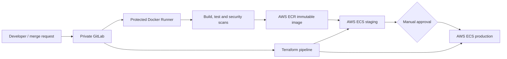

# Code Keeper

Code Keeper is the delivery platform for the CRUD Master microservices. It
deploys a private GitLab instance and Docker Runner with Ansible, then uses
reusable GitLab CI/CD templates to test, scan, package and deploy the
applications and their AWS infrastructure.

The solution has five independent private GitLab projects:

| Project | Responsibility |
|---|---|
| `code-keeper` | Ansible automation, shared CI/CD templates and deployment scripts |
| `inventory-app` | Inventory source code, tests, Dockerfile and application pipeline |
| `billing-app` | Billing consumer source code, tests, Dockerfile and application pipeline |
| `api-gateway-app` | Gateway source code, tests, Dockerfile and application pipeline |
| `cloud-infrastructure` | Terraform for the shared AWS resources, staging and production |

Keeping every application and the infrastructure in its own repository allows
independent changes and pipelines, as required by the project.

This repository also has its own pipeline: it syntax-checks the Ansible
playbooks and shell deployment script and scans the repository for secrets.

## Architecture



GitLab and its Runner are hosted on the private Fedora/Tailscale network. AWS
contains two similar ECS environments, `staging` and `production`. Terraform
provisions the infrastructure; application pipelines promote the exact Docker
image tested in staging to production.

## Repository contents

```text
.
├── ansible/
│   ├── inventories/             # Example inventory; real inventory is ignored
│   ├── playbooks/               # GitLab, bootstrap and Runner playbooks
│   └── roles/                   # Idempotent GitLab/Runner configuration
├── ci-templates/                # Shared application and Terraform pipelines
├── docs/                        # Contracts, infrastructure and recovery runbooks
├── scripts/deploy-ecs-service.sh
└── README.md
```

## Prerequisites

- A Linux host reachable by both developers (Tailscale is used here)
- Docker Engine with the Compose plugin
- Python 3, Ansible and SSH access with `sudo`
- An AWS account, AWS CLI credentials and the Cloud Design Terraform backend
- The three application repositories and the independent infrastructure repo

Install the pinned Ansible collection:

```bash
cd ansible
ansible-galaxy collection install -r requirements.yml
```

## Configuration and GitLab deployment

Create the local inventory and encrypted vault. These real files are ignored
by Git and only their examples are committed.

```bash
cd ansible
cp inventories/hosts.yml.example inventories/hosts.yml
cp vault.example.yml vault.yml
ansible-vault encrypt vault.yml
```

Set the host, remote user and SSH key in `inventories/hosts.yml`. Store the
GitLab root password in the encrypted vault, then deploy GitLab:

```bash
ansible-playbook playbooks/deploy-gitlab.yml \
  --ask-vault-pass --extra-vars '@vault.yml'
```

Sign in as `root`, create a personal access token with `api` scope and save it
as `vault_gitlab_bootstrap_token` in the encrypted vault. The bootstrap
playbook creates the private group/projects, protects `main`, and configures
cross-project access to the shared templates:

```bash
ansible-playbook playbooks/bootstrap-gitlab.yml \
  --ask-vault-pass --extra-vars '@vault.yml'
```

Create a protected group Runner with the `docker-private` tag. Save its
`glrt-` authentication token as `vault_gitlab_runner_token`, then deploy it:

```bash
ansible-playbook playbooks/deploy-runner.yml \
  --ask-vault-pass --extra-vars '@vault.yml'
```

All playbooks are idempotent and may be run again safely. Detailed recovery
steps are in [docs/recovery.md](docs/recovery.md).

## Required GitLab CI/CD variables

Configure secrets in GitLab Settings > CI/CD > Variables, never in source
files. Credential variables are masked and protected; environment-specific
values should be scoped to `staging` or `production`.

- `AWS_ACCESS_KEY_ID`
- `AWS_SECRET_ACCESS_KEY`
- `AWS_REGION`
- `ECR_REGISTRY`
- `TF_STATE_BUCKET`
- `TF_IMAGE_TAG`
- `STAGING_API_URL` and `PRODUCTION_API_URL`
- `COGNITO_CLIENT_ID_STAGING` and `COGNITO_CLIENT_ID_PRODUCTION`

The AWS credentials belong to a dedicated CI IAM user with only the ECR, ECS
and Terraform permissions required by these pipelines. See
[docs/contracts.md](docs/contracts.md) for the complete delivery contract.

## Application CI/CD

Every application repository includes the shared templates and defines its
service/container names. A protected `main` pipeline executes:

```text
build -> test -> scan -> containerize -> deploy_staging -> verify_staging
      -> approve_production -> deploy_production -> verify_production
```

- **Build:** compiles and packages the Python service.
- **Test:** runs its unit/integration tests.
- **Scan:** Bandit scans source code and `pip-audit` checks dependencies.
- **Containerize:** builds the Docker image, pushes the immutable commit-SHA
  tag to ECR and blocks on HIGH/CRITICAL Trivy findings.
- **Staging:** registers a new ECS task revision and waits for a completed
  rollout before verification.
- **Approval:** a protected manual job gates production.
- **Production:** promotes the same tested image; it is never rebuilt.

Only protected branches can publish or deploy. GitLab `resource_group` locks
also prevent concurrent deployments of the same service/environment.

## Infrastructure pipeline

The independent `cloud-infrastructure` project uses the shared Terraform
template:

```text
init -> validate -> plan -> apply_staging -> verify_staging
     -> approve_production -> apply_production -> verify_production
```

Staging and production use the same modules but separate VPCs, services,
databases, secrets and S3 state keys. Apply jobs consume the saved plan
artifact, so the reviewed plan is exactly what Terraform applies. Destroy jobs
are manual and additionally require `CONFIRM_DESTROY=yes`.

State layout, deployment behaviour, rollback and cost controls are documented
in [docs/infrastructure.md](docs/infrastructure.md).

## Security and dependency maintenance

- `main` is protected; changes are merged through reviewed merge requests.
- Credentials are kept in Ansible Vault or protected/masked GitLab variables.
- The Runner is protected and accepts only tagged `docker-private` jobs.
- Images use immutable commit-SHA tags and are scanned before deployment.
- Bandit, `pip-audit` and Trivy automatically monitor source, Python packages
  and container packages on every protected pipeline.
- Tool/container versions are pinned. Once per month, maintainers run the
  application pipelines, review scanner advisories and outdated dependencies,
  update pins in a merge request, and promote only after staging succeeds.
  Critical advisories are handled immediately rather than waiting for the
  monthly review.

## Audit and operational verification

List the automation without changing the hosts:

```bash
cd ansible
ansible-playbook playbooks/deploy-gitlab.yml --list-tasks
ansible-playbook playbooks/deploy-runner.yml --list-tasks
```

Verify GitLab and Runner on their host:

```bash
docker ps --filter name=code-keeper-gitlab
docker ps --filter name=code-keeper-runner
docker exec code-keeper-runner gitlab-runner verify
```

Verify the AWS deployments:

```bash
aws ecs list-services --cluster cloud-design-staging-cluster
aws ecs list-services --cluster cloud-design-production-cluster
aws ecs describe-services --cluster cloud-design-production-cluster \
  --services inventory-app billing-app api-gateway-app
aws ecr describe-images --repository-name cloud-design/inventory-app
```

For the live demonstration, open each repository's latest pipeline and show
the successful jobs, the production manual approval, and the immutable image
SHA used by both environments. Then run the inventory and billing API smoke
tests through the authenticated gateway.

## Rollback

An application rollback selects the previous ECR commit-SHA image, registers a
new task revision and waits for ECS stability. An infrastructure rollback
reverts the offending Terraform commit and sends the newly generated plan
through the same staging and production approval path. Exact commands and
GitLab/Runner recovery steps are in [docs/recovery.md](docs/recovery.md).
